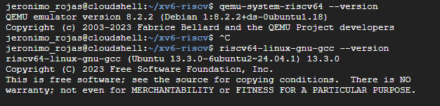
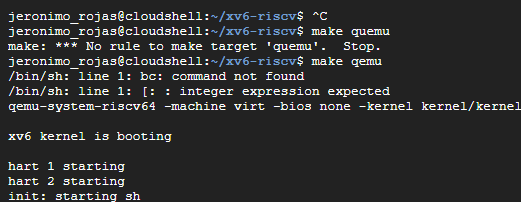
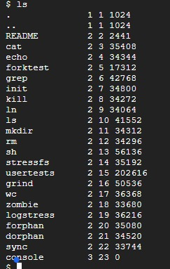
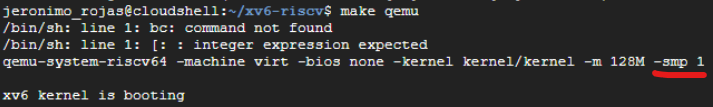
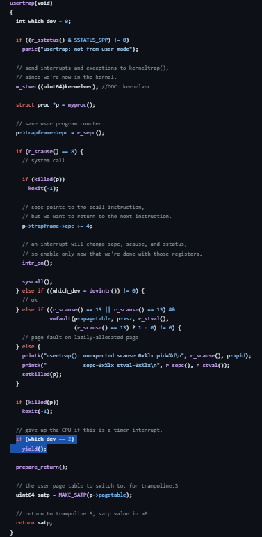
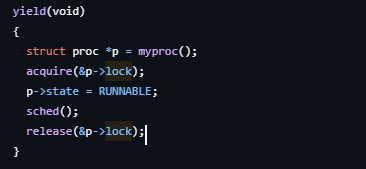
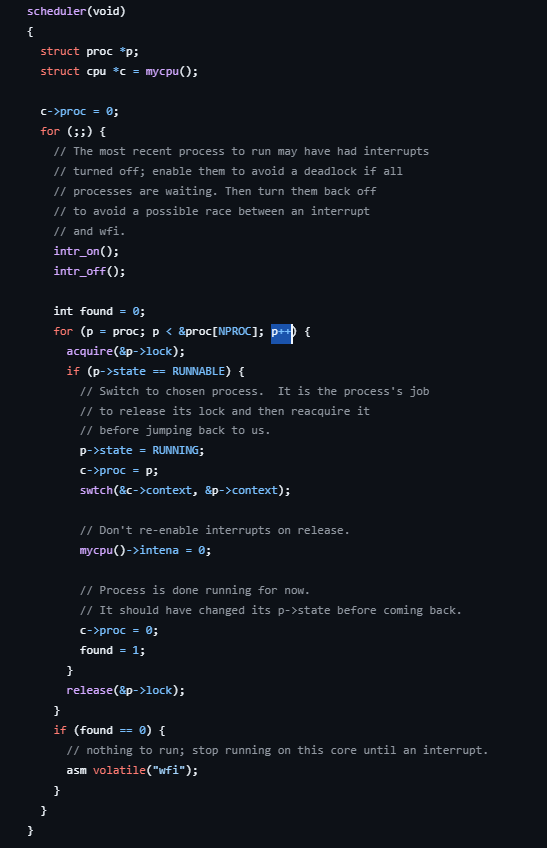

# Tarea #2 SO

**Luis Felipe Velasco Chilito 202517245**

**Jeronimo Rojas Imbachi 202517760**

## 1. Preparar el repositorio y el entorno

**Parte 1:**

1. La versión de Linux del sistema operativo donde se clonó el código fuente de xv6 fue: Ubuntu 24.04.5

2. El identificador del commit del código fuente desde el cual se comenzó a trabajar fue: eeb7b415dbcb12cc362d0783e41c3d1f44066b17

**Parte 2:**

1. Las herramientas usadas para ejecutar y compilar xv6 fueron:

   - riscv64-linux-gnu-gcc (Ubuntu 13.3.0-6ubuntu2~24.04.1) 13.3.0

   - QEMU emulator version 8.2.2



*Imagen 1. Versiones de las herramientas utilizadas para ejecutar y compilar xv6*

## 2. Compilar y ejecutar XV6

**Parte 1:**



*Imagen 2. Demostración de xv6 booteando*



*Imagen 3. Resultado del comando “ls” dentro de xv6*

**Parte 2:**

Para establecer una CPU virtual en xv6 se cambió el valor del parámetro CPUs por 1 en el archivo Makefile del repositorio.



*Imagen 4. El emulador QEMU recibe la cantidad de procesadores (en la imagen, 1 procesador) a través de la bandera -smp.*

## 3. Investigar el planificador original

**Parte 1:**

1. El algoritmo de planificación que utiliza xv6 es Round Robin, ya que cada vez que hay un “timer interrupt” durante la ejecución de un proceso, este entrega la CPU (imagen 5) y el scheduler ejecuta el siguiente proceso en estado “RUNNABLE” (imagen 7).

2. La función que implementa el algoritmo de planificación para seleccionar el siguiente proceso a ejecutar es “scheduler” en el archivo proc.c en la ruta “kernel/proc.c”.

3. La forma en la que se relaciona la selección de procesos con los estados de los procesos y los eventos que permiten recuperar la CPU es:

   1. “scheduler” toma un proceso de la tabla de procesos proc y, si está en estado “RUNNABLE”, lo pasa a estado “RUNNING” (imagen 7).

   2. “usertrap” hace que el proceso entregue la CPU por un “timer interrupt” (imagen 5).

   3. “yield” pasa el proceso a estado “RUNNABLE” (imagen 6).

   4. Se repiten los pasos 1, 2 y 3 con el siguiente proceso en la tabla de procesos proc (imagen 7).

4. Al ejecutar make, el compilador cruza el archivo kernel/proc.c y lo traduce a instrucciones de ensamblador de RISC-V (por ejemplo, cómo recorrer la tabla de procesos ptable, cómo verificar estados RUNNABLE, etc.), empaquetándolo dentro de kernel/kernel. QEMU carga kernel/kernel en la memoria RAM virtual y la CPU emulada empieza a ejecutar el código. El kernel arranca, inicializa sus estructuras y las CPUs virtuales saltan a ejecutar el bucle infinito de la función scheduler() ubicada en kernel/proc.c.



*Imagen 5. En la función “usertrap” del archivo trap.c se indica que, dado un “timer interrupt”, el proceso entrega la CPU.*



*Imagen 6. En la función “yield” del archivo proc.c el “state” del proceso “p” se cambia a “RUNNABLE”.*



*Imagen 7. En la función “scheduler” del archivo proc.c la operación **“p++”** hace que siempre se ejecute el siguiente proceso en estado “RUNNABLE” del anterior ejecutado pasándolo a “RUNNING”.*

## 4. Describir MLFQ y explorar su incorporación

**Descripción de MLFQ basada en lo estudiado:**

Entendemos que MLFQ es un algoritmo de planificación cuyas reglas son:

1. Cada proceso entrante se ubica en la cola de mayor prioridad.

2. Cuando un proceso cumple un tiempo T de ejecución en la misma cola, pasa a la siguiente cola de menor prioridad.

3. Se ejecuta el proceso de mayor prioridad y, si los procesos tienen la misma prioridad, se ejecutan por turnos (Round Robin).

4. Pasado un tiempo S, todos los procesos se reubican en la cola de mayor prioridad.

**Prompt para realizar ejercicio socrático:**

Actúa como tutor socrático de una pareja de estudiantes de cuarto semestre de Ingeniería de Sistemas. Conocemos C++ y hemos comenzado a explorar XV6 para RISC-V.

Queremos identificar y justificar qué se necesitaría para incorporar MLFQ a XV6. En esta entrega no vamos a implementarlo.

Nuestra descripción inicial del algoritmo, escrita antes de esta conversación:

“Entendemos que MLFQ es un algoritmo de planificación cuyas reglas son:

1\. Cada vez que entra un proceso, este se ubica en la cola de mayor prioridad.

2\. Cuando un proceso cumple un tiempo T de ejecución en la misma cola, pasa a la siguiente cola de menor prioridad.

3\. Se ejecuta el proceso de mayor prioridad y, si los procesos por ejecutar tienen la misma prioridad, se ejecutan por turnos (RR).

4\. Pasado un tiempo S, todos los procesos se ubican en la cola de mayor prioridad.”

Lo que averiguamos del planificador original y de su incorporación al sistema compilado:

“El algoritmo de planificación que utiliza xv6 es Round Robin, ya que cada vez que hay un “timer interrupt” durante la ejecución de un proceso, este entrega la CPU (imagen 5) y el scheduler ejecuta el siguiente proceso en estado “RUNNABLE” (imagen 7).

1. La función que implementa el algoritmo de planificación para seleccionar el siguiente proceso a ejecutar es “scheduler” en el archivo proc.c en la ruta “kernel/proc.c”.

2. La forma en la que se relaciona la selección de procesos con los estados de los procesos y los eventos que permiten recuperar la CPU es:

   1. “scheduler” toma un proceso de la tabla de procesos proc y, si está en estado “RUNNABLE”, lo pasa a estado “RUNNING”.

   2. “usertrap” hace que el proceso entregue la CPU por un “timer interrupt”.

   3. “yield” pasa el proceso a estado “RUNNABLE”.

   4. Se repiten los pasos 1, 2 y 3 con el siguiente proceso en la tabla de procesos proc.

3. Al ejecutar make, el compilador cruza el archivo kernel/proc.c y lo traduce a instrucciones de ensamblador de RISC-V (por ejemplo, cómo recorrer la tabla de procesos ptable, cómo verificar estados RUNNABLE, etc.), empaquetándolo dentro de kernel/kernel. QEMU carga kernel/kernel en la memoria RAM virtual y la CPU emulada empieza a ejecutar el código. El kernel arranca, inicializa sus estructuras y las CPUs virtuales saltan a ejecutar el bucle infinito de la función scheduler() ubicada en kernel/proc.c.”

Reglas de interacción:

1\. Formula una sola pregunta principal por turno y espera nuestra respuesta. No presentes una lista completa de cambios ni una arquitectura resuelta.

2\. Empieza examinando nuestra descripción de MLFQ. Ayúdanos a detectar reglas ambiguas, ausentes o contradictorias. No sustituyas nuestra descripción por una versión terminada ni elijas silenciosamente una variante del algoritmo.

3\. Pídenos que propongamos y justifiquemos las decisiones que faltan. Después, ayúdanos a comprobarlas con ejemplos pequeños de procesos y decisiones de planificación que nosotros debamos resolver.

4\. Guíanos para relacionar cada regla con XV6. Antes de sugerir una modificación, pregúntanos qué comportamiento necesitamos y qué evidencia del código respalda nuestra propuesta.

5\. No supongas que tienes acceso a nuestro repositorio. Pide los fragmentos necesarios y distingue lo observado de lo que todavía sea una hipótesis. No inventes archivos, funciones o comportamientos de nuestra versión.

6\. No entregues código de implementación, parches, una lista cerrada de archivos por modificar ni pseudocódigo que resuelva el planificador. Revisa nuestras propuestas y señala problemas mediante preguntas y pistas graduales. Puedes explicar conceptos previos con ejemplos mínimos.

7\. Si nos bloqueamos, reduce la dificultad de la pregunta y ofrece una pista concreta. Si pedimos la solución directa, conserva el modo socrático.

El objetivo es que nosotros logremos:

A\. Redactar una descripción revisada y coherente de la variante de MLFQ considerada.

B\. Explicar qué cambios necesitaría XV6 para soportarla, indicando para cada uno su propósito, su relación con las reglas y la evidencia del código que lo justifica.

C\. Proponer escenarios para comprobar una futura implementación del algoritmo MLFQ en el sistema operativo XV6. Pídenos que expliquemos qué procesos participarían, qué harían, qué regla comprobaríamos y qué comportamiento esperaríamos observar. No nos entregues los escenarios resueltos. En esta tarea solo los describiremos; no vamos a programarlos ni ejecutarlos.

Mantén el análisis dentro del alcance de una propuesta: no necesitamos implementar MLFQ ni construir un selector de planificadores. Ayúdanos a registrar las cuestiones que queden pendientes de investigación.

Al finalizar, pídenos que redactemos nuestras conclusiones. Comprueba su consistencia mediante una última pregunta aplicada a un caso concreto, sin escribir por nosotros el reporte.

Comienza con una pregunta que permita comprobar cómo entendemos una regla de nuestra descripción inicial de MLFQ.

**Descripción de MLFQ final:**

El algoritmo de planificación MLFQ se rige por las siguientes reglas fundamentalmente:

1. Todo nuevo proceso es asignado inicialmente a la cola de mayor prioridad.

2. Si un proceso acumula un tiempo de ejecución T en su nivel actual, se degrada a la siguiente cola de menor prioridad.

3. Si un proceso en una cola Q cede voluntariamente la CPU antes de agotar su cuota, el presupuesto de tiempo restante en Q se calcula como: T - (tiempo ejecutado en Q).

4. El planificador prioriza la ejecución de los procesos situados en las colas de mayor nivel. En caso de existir múltiples procesos dentro de la misma prioridad, se aplica la planificación por turnos (Round Robin).

5. Tras un intervalo de tiempo global S, todos los procesos del sistema se reubican en la cola de máxima prioridad y su tiempo consumido se restablece a 0.

**Propuesta de cambios:**

1\. <u>Parámetros del algoritmo (kernel/param.h)</u>: Definir las constantes NQUEUE (cantidad de niveles de prioridad), MLFQ_T (presupuesto *T* en ticks por nivel) y MLFQ_S (intervalo global *S* en ticks para el reinicio). Tenerlas aquí permite ajustar el comportamiento del planificador sin tocar la lógica del kernel.

2\. <u>Estado por proceso (kernel/proc.h y kernel/proc.c)</u>: Agregar tres campos a struct proc: queue (nivel actual, donde 0 es máxima prioridad), budget (ticks consumidos en ese nivel) y seq (orden de entrada a la cola).

- En allocproc(), inicializar queue = 0 y budget = 0 para que todo proceso nuevo arranque en la cola de mayor prioridad (Regla 1).

- En freeproc(), limpiar los tres campos al liberar la ranura.

3\. <u>Turnos para Round Robin (kernel/proc.c)</u>: Mantener un contador global atómico (sched_seq) y asignarlo a p->seq en los cinco puntos donde un proceso pasa a RUNNABLE: userinit(), fork(), yield(), wakeup() y kill(). Esto garantiza el orden FIFO/Round Robin dentro de un mismo nivel (Regla 4).

4\. <u>Consumo de presupuesto y degradación (kernel/trap.c)</u>: En usertrap() y kerneltrap(), dentro del bloque de interrupción de reloj (if(which_dev == 2)) y antes de llamar a yield(), tomar p->lock e incrementar p->budget.

- Si budget >= MLFQ_T y el proceso no está en el último nivel (queue < NQUEUE - 1), degradarlo (queue++) y reiniciar budget = 0 (Regla 2). En la última cola simplemente rotará por Round Robin.

- Se hace aquí y no en clockintr() porque en estos manejadores myproc() identifica exactamente qué proceso corre en cada CPU.

- Como sleep() no modifica budget, si un proceso cede voluntariamente la CPU antes de agotar su cuota, conserva lo ya gastado y mantiene su presupuesto restante MLFQ_T - budget al despertar (Regla 3). *(Nota: al contabilizar por ticks, si un proceso se bloquea antes de la interrupción de reloj, esa fracción de tick no se descuenta).*

5\. <u>Reinicio global periódico (kernel/trap.c)</u>: En clockintr(), cada vez que ticks % MLFQ_S == 0, recorrer proc[] y restablecer queue = 0 y budget = 0 en todos los procesos activos (state != UNUSED) para evitar inanición (Regla 5). Es indispensable soltar tickslock antes de adquirir los p->lock para evitar un *deadlock* por orden de bloqueos.

6\. <u>Selección en el planificador (kernel/proc.c)</u>: Reemplazar la búsqueda lineal en scheduler() para elegir entre los procesos RUNNABLE al de menor queue (mayor prioridad) y, en caso de empate, al de menor seq (Regla 4). Luego, tomar su p->lock y revalidar que siga RUNNABLE (por si otra CPU lo tomó primero) antes de pasarlo a RUNNING y ejecutar swtch(). Como yield() se dispara en cada tick, un proceso de mayor prioridad que despierte desalojará al actual en el siguiente tick sin necesidad de modificar wakeup().

7\. <u>Visualización del estado del planificador (kernel/proc.c)</u>: Modificar procdump() para que, además de pid, estado y nombre, imprima los campos queue, budget y seq de cada proceso. Esto permite observar con Ctrl-P en qué cola está cada proceso y cuánto presupuesto lleva, que es la evidencia que usan los escenarios de validación para comprobar las Reglas 1 a 5.

Dentro del ciclo que recorre proc[], ampliar la llamada a printf que imprime cada línea para incluir los tres campos nuevos. En la versión original de xv6 RISC-V esa línea es:

```c
printf("%d %s %s", p->pid, state, p->name);
```

y quedaría así:

```c
printf("%d %s %s queue=%d budget=%d seq=%d", p->pid, state, p->name, p->queue, p->budget, p->seq);
```

**Escenarios de validación:**

**Escenario 1:**

Configuración: 1 CPU virtual, 3 colas (queue 0, 1 y 2), T = 4 ticks por nivel y S = 100 ticks (valor suficientemente grande para que el reinicio global no intervenga en esta prueba).

Participantes:

- P1 y P2 (CPU-bound): Dos procesos que ejecutan bucles aritméticos infinitos.

- P3 (Interactivo): Un proceso que alterna ráfagas cortas de cálculo con llamadas a sleep().

Qué hacen:

- P1 y P2 arrancan juntos en el tick 0 y, al tener una sola CPU, se turnan en Round Robin. Cada uno consume 4 ticks en queue 0 y luego 4 ticks en queue 1, por lo que hacia el tick 16 ambos han caído a queue 2.

- En ese momento nace P3, hace cálculo durante 2 ticks (la mitad de T=4) y llama a sleep(2) para ceder la CPU. Al despertar, repite el ciclo dos veces más.

Reglas que comprueba:

- Regla 1: P1, P2 y P3 nacen todos en queue = 0.

- Regla 2: P1 y P2 bajan de nivel cada vez que acumulan 4 ticks en su nivel actual.

- Regla 3: Al dormirse tras 2 ticks, P3 conserva sus 2 ticks restantes (4-2) sin reiniciar su contador.

- Regla 4: P1 y P2 rotan en Round Robin dentro de un mismo nivel, pero P3 los desaloja en el siguiente tick después de despertar por estar en una cola superior.

Comportamiento esperado: Al presionar Ctrl-P antes del tick 16, veremos a P1 y P2 alternándose en queue 2. Cuando P3 despierta, toma la CPU en el siguiente tick en queue 0 manteniendo el budget acumulado de sus ráfagas anteriores (budget = 2 tras el primer sleep), y recién baja a queue 1 cuando suma los 4 ticks completos, es decir, al terminar su segunda ráfaga. Su tercera ráfaga se ejecuta en queue 1, que sigue teniendo mayor prioridad que queue 2, donde están P1 y P2.

**Escenario 2:**

Configuración: 1 CPU virtual, 3 colas (queue 0, 1 y 2), T = 4 ticks por nivel y S = 20 ticks.

Participantes:

- Ppesado: Un proceso de larga duración que realiza cálculos e imprime un punto (.) en consola cada cierto avance.

- Pcoordinador: Un proceso que, a partir del tick 9, crea con fork() los procesos cortos uno tras otro y espera con wait() a que cada uno termine.

- Pcorto1, Pcorto2, ...: Una cadena de procesos breves creados secuencialmente por Pcoordinador.

Qué hacen:

- Ppesado arranca solo en el tick 0. Al llegar al tick 8 ya agotó sus presupuestos (4 ticks en queue 0 y 4 ticks en queue 1) y queda relegado a queue 2.

- A partir del tick 9, Pcoordinador lanza procesos cortos uno tras otro: cada Pcortoi trabaja durante 2 ticks (menos que T=4) y termina con exit().

- La prueba corre hasta superar el tick 20 (S=20).

Reglas que comprueba:

- Regla 2: Ppesado baja a queue 1 y luego a queue 2 al acumular 4 ticks en cada nivel.

- Reglas 1 y 4: Cada nuevo Pcortoi entra en queue = 0 y acapara la CPU, dejando a Ppesado en inanición en queue = 2.

- Regla 5: Al alcanzarse el tick 20, el planificador promueve a todos los procesos activos a queue = 0 y reinicia su budget a 0.

Comportamiento esperado: Entre los ticks 9 y 19, Ppesado prácticamente deja de imprimir puntos porque los procesos cortos monopolizan queue 0. Exactamente al cumplirse el tick 20, Ctrl-P mostrará que Ppesado volvió a queue = 0 (budget = 0), se turna en Round Robin con el proceso corto activo y vuelve a imprimir en pantalla.

## 5. Documentación IA:

**Modelo usado**: Gemini AI 4.0 Hydrogen

**Fragmentos de intercambio socrático:**

Intervención IA:

¡Hola, equipo! Qué excelente punto de partida han alcanzado al analizar el funcionamiento de Round Robin en kernel/proc.c y documentar cómo XV6 compila y ejecuta el planificador.

Para comenzar a pulir nuestra descripción del MLFQ (Objetivo A), analicemos su Regla 1:

“Cada vez que entra un proceso este se ubica en la cola de mayor prioridad.”

Pensando en el ciclo de vida de un proceso en un sistema operativo, ¿cómo interpretan exactamente ese «cuando entra»? Específicamente, ¿aplicaría únicamente cuando el proceso nace (por ejemplo, tras un fork()), o también cada vez que un proceso se desbloquea tras esperar una operación de entrada/salida? ¿Qué justificación le darían a esa decisión pensando en el comportamiento de tareas interactivas frente a las que consumen mucha CPU?

Nuestra respuesta:

El tiempo de ejecución se resta de T y el proceso se quedaría en la misma prioridad con el resto de tiempo; además, las consecuencias serían que ningún proceso interactivo podrá estar en la misma prioridad, puesto que su tiempo T se acabará agotando, mientras que los intensivos acabarían por completo el tiempo T en una cola, bajando así su prioridad.

Intervención IA:

¡Excelente análisis, equipo! Acaban de identificar por ustedes mismos una de las vulnerabilidades más clásicas del diseño de un MLFQ (conocida en la literatura como gaming the scheduler o, en este caso, degradación inevitable de tareas interactivas).

Como bien dedujeron:

1. Si descontamos cada pequeña ráfaga de E/S del mismo presupuesto *T* sin reiniciarlo, un proceso interactivo (como una shell o un editor) eventualmente agotará su tiempo *T* y terminará degradado al fondo junto con los procesos intensivos en CPU, perdiendo su capacidad de respuesta rápida.

2. Por otro lado, si reiniciáramos *T* a cero cada vez que cede la CPU, un proceso malicioso o intensivo en CPU podría hacer una operación de E/S justo antes de agotar *T* para mantenerse eternamente en la cola de máxima prioridad.

Aquí es donde ustedes, como diseñadores de esta variante para XV6, deben tomar una postura explícita para dejar la Regla 2 libre de ambigüedades antes de pasar a la siguiente regla.

¿Cómo reescribirían exactamente la Regla 2 para decidir qué ocurre con el tiempo acumulado de ejecución (*T*) cuando un proceso cede voluntariamente la CPU antes de agotar su cuota, y cómo justificarían esa decisión para equilibrar el comportamiento en XV6?

Nuestra respuesta:

Adicionalmente a la regla 2 que tenemos, si el proceso libera la CPU antes de que se acabe el tiempo T, entonces, al retomar la CPU, el tiempo restante será igual a T - tiempo de ejecución.

Intervención IA:

¡Excelente decisión de diseño! Acaban de establecer una contabilidad estricta del presupuesto de CPU por nivel (allotment): el tiempo acumulado no se perdona ni se reinicia al ceder la CPU voluntariamente, por lo que al volver a ejecutar, el proceso conserva exactamente su presupuesto restante (*T - tiempoejecutado*) hasta agotarlo y descender de nivel. Esto protege el sistema contra procesos que intenten abusar cediendo la CPU justo antes de expirar su cuota.

Con la Regla 2 clarificada, examinemos ahora su Regla 3 para detectar posibles ambigüedades:

“3. Se ejecuta el proceso de mayor prioridad y si los procesos por ejecutar tienen la misma prioridad se ejecutan por turnos (RR).”

Cuando varios procesos están listos (RUNNABLE) en esa misma cola de mayor prioridad y se ejecutan por turnos (Round Robin), ¿cada cuánto tiempo (cuanto o quantum de RR) ocurre ese cambio de turno entre ellos, y ese quantum tiene alguna relación fija con el presupuesto *T* de la cola o puede variar entre diferentes niveles de prioridad?

Nuestra respuesta:

El tiempo con el que cambia el turno entre ellos varía dependiendo de la configuración del SO, y este tiempo puede cambiar entre diferentes niveles de prioridad.

## 6. Reflexiones

**Jeronimo Rojas Imbachi:**

Comprendí el funcionamiento del MLFQ, aporté a la idea del “timer interrupt” para así poder deducir qué tipo de algoritmo de planificación utiliza el xv6, y necesito estudiar más las funciones que debemos cambiar para poder usar el MLFQ.

**Luis Felipe Velasco Chilito:**

Me quedó claro el funcionamiento de Round Robin y MLFQ, aporté la idea de la configuración de 1 núcleo virtual en xv6, y necesito estudiar más el código de xv6 para entender todos los parámetros que participan en el cambio de contexto entre procesos.
